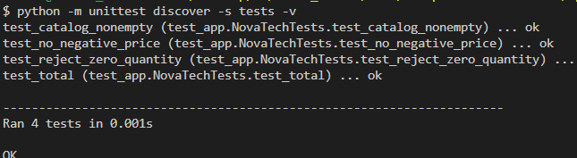
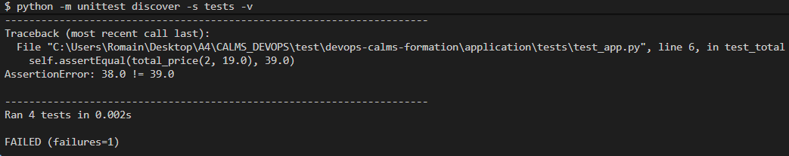
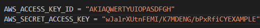

# Application NovaTech 

Mini-service en Python standard (aucune dépendance externe). Commandes à lancer **depuis le dossier `application/`** :

```bash
python -m unittest discover -s tests -v
python app.py
# autre terminal : curl http://127.0.0.1:8000/health
```

Endpoints : `/health` et `/products`. La fonction `total_price` sert aux tests ; elle n'est pas exposée par une API de commande. Il s'agit d'un support de laboratoire, **pas** d'une application de paiement de production.

## Pièges fréquents

- Lancer les tests depuis `application/` : depuis la racine du dépôt, Python ne trouve pas le module `app` (`ModuleNotFoundError: No module named 'app'`).
- Windows : si `python` n'est pas reconnu, essayer `py`. Dans Windows PowerShell 5.1, `curl` est un alias d'`Invoke-WebRequest` : utiliser `curl.exe` ou un navigateur.
- Le port 8000 doit être libre.

## Expérience

1. Exécuter les tests et noter le résultat.\

2. Modifier volontairement un attendu du test `test_total` (par exemple attendre `39.0`) et constater l'échec : `AssertionError: 38.0 != 39.0`.

3. Conserver les preuves de l'échec, restaurer le bon attendu et vérifier le succès.
4. Pousser en branche : la CI déjà présente à la racine du dépôt (`.github/workflows/ci.yml` ou `.gitlab-ci.yml`) lance les tests, une recherche de secrets (gitleaks) et, en cas d'échec, une notification ChatOps simulée. Ouvrir une revue et relever les liens vers les runs.

Cas d'un problème de clef :

avec les clefs suivantes :\

5. Facultatif : si Docker est disponible, `docker compose up --build -d`, vérifier `/health`, `docker compose ps` (état `healthy`), puis `docker compose down`.

## Fichiers

| Fichier | Rôle |
|---|---|
| `app.py`, `tests/` | Service et tests unitaires |
| `Dockerfile` | Image : utilisateur non root, contrôle de santé (`HEALTHCHECK`), logs non mis en tampon |
| `compose.yaml` | Environnement local décrit as code (démarche IaC), port publié sur `127.0.0.1` uniquement |
| `github-ci.yml`, `gitlab-ci.yml` | Copies de référence des CI installées à la racine du dépôt |

Le `compose.yaml` illustre une démarche Infrastructure as Code : l'environnement est décrit dans un fichier versionné, relu et rejouable. Docker et Docker Compose ne sont pas pour autant des outils IaC au même titre que Terraform ou OpenTofu : ils ne provisionnent pas de ressources d'infrastructure (réseaux, machines, services cloud) et ne gèrent pas d'état. Ce fichier ne constitue donc ni une démonstration de provisionnement cloud, ni une garantie de sécurité.
