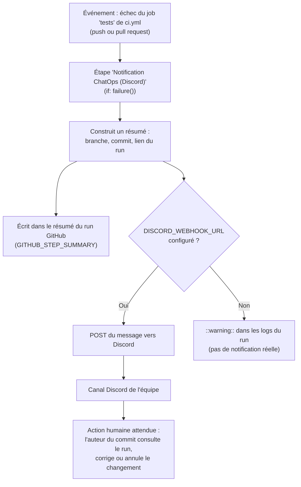

# Expérience - ChatOps (TP3 puis réalisé en vrai au TP4)

## Hypothèse
Une notification automatique envoyée dans un canal d'équipe à chaque échec de CI réduit le délai de détection d'un problème, sans ajouter de bruit, si elle ne se déclenche que sur échec et contient l'information nécessaire pour agir.

## Prérequis
- CI fournie (`.github/workflows/ci.yml`), déjà fonctionnelle (job `tests`).
- Un webhook Discord créé dans un salon de l'équipe, enregistré comme secret GitHub `DISCORD_WEBHOOK_URL` (Settings → Secrets and variables → Actions).

## Démarche

**Schéma du message ChatOps (TP3, étape 3) :**

**Information incluse dans le message :** branche concernée, commit, lien direct vers le run CI en échec, action attendue. Volontairement minimal : pas de détail du code, pas de donnée sensible.

**Risque de bruit étudié :** la notification ne se déclenche **que sur échec** (`if: failure()`), jamais sur succès, pour éviter qu'un flux constant de messages fasse baisser l'attention de l'équipe au moment où un vrai problème survient (cf. module 4, Q4.6).

**Confidentialité :** l'URL du webhook Discord est stockée comme secret GitHub, jamais en clair dans `ci.yml` ; le message ne contient que des métadonnées techniques (branche/commit/lien), pas de contenu applicatif.

## Résultat observé
**Réellement testé le 2026-10-21** (pas une simulation) : après configuration du webhook Discord et du secret `DISCORD_WEBHOOK_URL`, un échec volontaire de test déclenché sur la branche de travail a bien produit un message dans le salon Discord de l'équipe, en plus du résumé affiché dans l'onglet Actions de GitHub.

## Preuve
- Fichier modifié : `.github/workflows/ci.yml` (étape « Notification ChatOps (Discord) »).
- Capture d'écran : `preuves/discord_webhook.png`, message posté par `ChatOpsBot` le 21 octobre 2026 à 14h47 dans le salon `#chat-ops` du serveur Discord du groupe.
- Branche : `J2_testing_nicolas` ; commit : `1f5bed1bbece71645a1710544acd30cb3c1566f6` ; run : https://github.com/GroupeHuitre/devops-calms-formation/actions/runs/39602448029

## Limites
- Le message ne distingue pas les niveaux de gravité (un test cassé par erreur vs un échec critique) : tout échec produit le même message.
- Le secret `DISCORD_WEBHOOK_URL` n'est configuré que sur ce dépôt/organisation ; une branche créée dans un fork externe sans ce secret retombe sur le résumé GitHub uniquement (comportement volontairement non bloquant, voir le `else` dans `ci.yml`).
- Cette notification couvre uniquement l'échec de la CI (tests), elle ne couvre pas un incident en production réelle (pas de monitoring applicatif branché ici).

## Prochaine action
Décider collectivement si d'autres événements méritent une notification (ex. échec du job `secrets`), en gardant le principe « rare et actionnable » pour ne pas recréer le bruit identifié en Q4.6.
