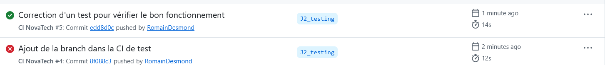
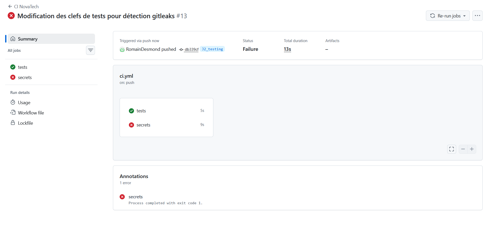

# Preuves
Images et commentaires des tets GitLeaks et CI/CD basique

| Date | Preuve (fichier ou URL) | Commit / MR | Réel, simulé ou bloqué | Commentaire |
|---|---|---|---|---|
|21/10/2026|| Ajout de la branch dans la CI de test |Réel | Changement d'un test, la valeur est passée à 39 au lieu de 38 ce qui fait échouer le pipeline|
|21/10/2026| | Modification des clefs de tests pour détection gitleaks |Simulé |Ajout des faux token AWS suivant :  ce qui a créé les erreurs, suite à ça tous les push étaient refusés car un commit possédait des tokens en dur. Lorsque le token n'avait pas les particularités d'un token AWS, il n'était pas détecté. Dans un contexte réel il faut révoquer les secrets, puis il y a deux choix, le premier est de le mettre dans un .gitleaksignore. Le second, celui que l'on a utilisé est de supprimer l'élément de l'historique. Il est plus compliqué puisque l'on a dû utiliser git_filter_repo ce qui nous a pris 1 heure afin de l'utiliser correctement, l'ajout dans un gitleaks aurait pris quelques minutes au plus.|

